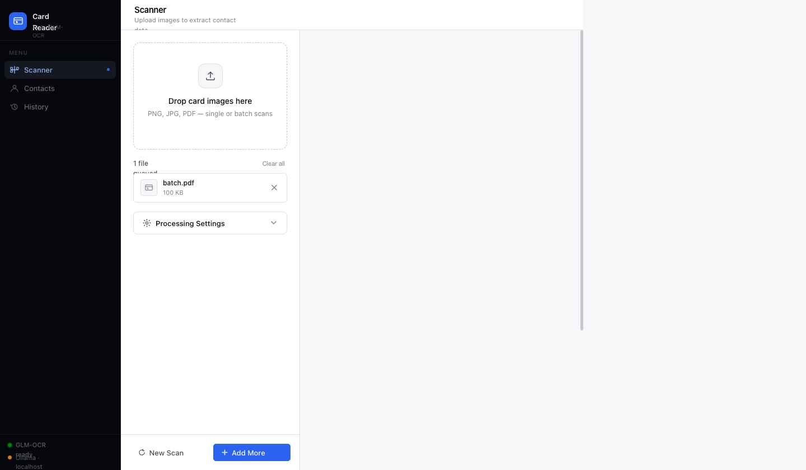
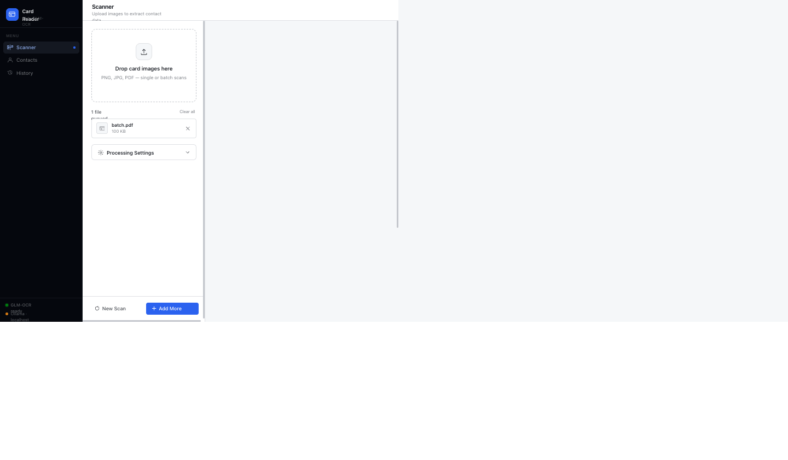

# 📇 Business Card Scanner

Local-first, AI-powered business card scanner. Drop in JPEG / PNG / PDF cards, get back clean contact records you can export to **VCF**, **Excel**, or **Outlook CSV** — without any image leaving your machine.

[](https://github.com/luizpersechini/businesscards/actions/workflows/ci.yml)
[](https://www.python.org/)
[](#-license)
[](https://github.com/luizpersechini/businesscards/commits/main)

> **v2.0** — FastAPI + React frontend, multi-provider LLM strategy (Ollama / vLLM / Claude / OpenAI), 216-test suite, CI on Python 3.10/3.11/3.12.

---

## 🎬 Screenshots

| Scanner | Results | Contacts |
|---|---|---|
|  |  |  |

---

## ✨ Highlights

- 🧠 **State-of-the-art OCR** — defaults to **GLM-OCR** (#1 on OmniDocBench v1.5 with a 94.62 score, only 0.9 B params, runs fully local via Ollama). Optional fallback to **Qwen2.5-VL**, **llama3.2-vision**, **llava**, **Claude**, or **OpenAI**.
- 📷 **Smart card detection** — automatic OpenCV pipeline with grid-layout fallback for contact-sheet scans, plus manual single-card and N×M-grid modes.
- 🧾 **QR-first short-circuit** — if a card's QR encodes a vCard / MECARD with enough data, vision is skipped entirely (saves ~20-30 s per card).
- 📤 **Multi-format export** — VCF (Outlook / iPhone Contacts), Excel, Outlook CSV, ZIP bundle of everything.
- 🛑 **Stop button** — cancel an in-flight scan from the UI; in-flight card finishes, no further work runs.
- 📜 **Scan history** — every run is archived locally with original images, parsed contacts, and exports. Browse, ZIP-download, or relaunch with new settings.
- 🏷️ **Smart name & phone parsing** — `phonenumbers` (Google libphonenumber) for international phone validation, `probablepeople` (CRF) for distinguishing "Banco do Brasil" (company) from "João da Silva" (person).
- 🔐 **100% local** — no external API calls unless you explicitly configure a cloud fallback.

---

## 🚀 Quick Start

### 1. Install system deps

```bash
# macOS
brew install zbar libheif tesseract

# Ubuntu / Debian
sudo apt-get install libzbar0 libheif1 tesseract-ocr
```

### 2. Install Ollama (recommended) and pull the OCR model

```bash
curl -fsSL https://ollama.com/install.sh | sh   # macOS / Linux
ollama pull glm-ocr
```

> **Why GLM-OCR?** 0.9 B parameters, loads in seconds, outperforms models 260× its size on document benchmarks. Ideal for business cards.

### 3. Install Python deps and run

```bash
pip install -r requirements.txt

# macOS only — let pyzbar find zbar
export DYLD_LIBRARY_PATH=/opt/homebrew/lib:$DYLD_LIBRARY_PATH

python3 server.py
```

Open **<http://localhost:8501>**. The FastAPI backend serves the React UI at `/` and exposes REST + SSE endpoints for the scan pipeline.

> 💡 On macOS, double-click the included `BusinessCardScanner.app` (built locally — see [QUICKSTART.md](QUICKSTART.md)) to start the server with one click and auto-open the browser.

---

## 🧩 Architecture

```
┌─────────────────────────────────────────────────────────────────┐
│  React UI (frontend/index.html)                                 │
│  ─ Upload, scan, edit, export, history, contacts                │
└──────────┬──────────────────────────────────────────────────────┘
           │ REST + SSE
┌──────────▼──────────────────────────────────────────────────────┐
│  FastAPI server.py                                              │
│  ─ /api/scan          (multipart upload → SSE stream)           │
│  ─ /api/scan/stop     (cooperative cancel)                      │
│  ─ /api/contacts      (CRUD + export VCF / XLSX / CSV)          │
│  ─ /api/history       (list / ZIP / delete past runs)           │
└──────────┬──────────────────────────────────────────────────────┘
           │
┌──────────▼──────────────────────────────────────────────────────┐
│  utils/                                                         │
│  ├─ card_processor       Per-card orchestration                 │
│  ├─ improved_card_detector   OpenCV detection + grid fallback   │
│  ├─ qr_reader            pyzbar + OpenCV (with MECARD support)  │
│  ├─ providers/           Strategy pattern, LOCAL-FIRST          │
│  │  ├─ ollama_provider   GLM-OCR / Qwen2.5-VL / llama3.2-vision │
│  │  ├─ vllm_provider     vLLM OpenAI-compatible API             │
│  │  ├─ claude_provider   Anthropic Claude vision                │
│  │  └─ openai_provider   OpenAI GPT-4o vision                   │
│  ├─ vcf_generator        vobject (round-trip tested)            │
│  ├─ export_processor     pandas + openpyxl                      │
│  ├─ history_manager      JSON metadata + per-run artifacts      │
│  └─ contacts_repository  JSON-backed contact store              │
└─────────────────────────────────────────────────────────────────┘
```

LOCAL-FIRST provider chain: every scan tries Ollama → vLLM → Claude → OpenAI in priority order, with the first available provider winning. Local providers stay loaded (`keep_alive: -1`) between cards so subsequent scans cost only an inference, not a model reload.

---

## 🛠️ Tech stack

| Layer | Library |
|---|---|
| Web UI | React (single-file shell) |
| API | FastAPI + uvicorn (REST + SSE) |
| Computer vision | OpenCV, pyzbar, pillow-heif |
| OCR / vision | Ollama (glm-ocr, qwen2.5vl, llama3.2-vision, llava…) |
| Cloud fallback | Anthropic Claude, OpenAI |
| Phone parsing | `phonenumbers` (Google libphonenumber) |
| Name parsing | `probablepeople` (CRF) |
| VCF generation | `vobject` |
| Excel export | `pandas` + `openpyxl` |
| PDF rendering | `pymupdf` |
| Tests | `pytest`, `pytest-cov`, `pytest-timeout`, `httpx` (TestClient) |

---

## 🤖 Recommended models

| Model | Size | Best for |
|---|---|---|
| **glm-ocr** ⭐ | 0.9 B | Default. Fastest, most accurate OCR for business cards. |
| qwen2.5vl | 7 B | Strong general VLM fallback (96.4 % DocVQA, 88.8 % OCRBench). |
| llama3.2-vision | 11 B | General vision, used historically. |
| llava:13b | 13 B | High-accuracy fallback when GPU memory allows. |

`ollama pull <model>` installs any of them; the model dropdown in the UI auto-detects what you have and pre-selects whatever's currently loaded into GPU to avoid expensive swaps.

---

## 🎮 Usage

1. **Upload** business card images or PDF (drag-and-drop or file picker).
2. **Configure** detection mode and vision model in the settings panel — defaults are usually fine.
3. **Process Cards** — watch live SSE progress per page / per card. Click **Stop scan** to cancel.
4. **Review** extracted contacts inline. **Edit** any field by clicking the pencil icon.
5. **Download** VCF / Excel / Outlook CSV individually or as a ZIP bundle.

Every run is auto-archived under `temp/history/` — see the History tab to browse, relaunch with new settings, or delete.

---

## 🔧 Troubleshooting

<details>
<summary><b>Ollama not detected</b></summary>

```bash
ollama serve                            # start the server
curl http://localhost:11434/api/tags    # verify it responds
ollama list                             # check installed models
```
</details>

<details>
<summary><b>QR codes not reading on macOS</b></summary>

`pyzbar` needs the zbar dylib path. Either use the bundled `BusinessCardScanner.app` (sets it for you), or:

```bash
export DYLD_LIBRARY_PATH=/opt/homebrew/lib:$DYLD_LIBRARY_PATH
python3 server.py
```
</details>

<details>
<summary><b>Only some cards detected in a grid scan</b></summary>

Switch the detection mode to **Manual — Grid Layout** in the settings panel and enter the correct rows × cols. The automatic mode falls back to a 4×2 / 2×4 grid based on aspect ratio when it can't detect cards individually, which doesn't always match real layouts.
</details>

<details>
<summary><b>Vision timeout / slow first card</b></summary>

- Bump the **Vision Timeout** slider (up to 600 s) for the cold-start case.
- Prefer **GLM-OCR** on slower hardware — it's an order of magnitude faster than 11 B+ vision models.
- `ollama ps` — confirm the model is on GPU. If it shows `100% CPU`, you're missing CUDA / Metal acceleration.
</details>

---

## 🧪 Tests

```bash
pytest tests/                           # 216 tests, ~5 s
pytest tests/ --cov=utils               # with coverage report (htmlcov/)
```

Coverage targets: `server.py` 100 %, `utils/qr_reader.py` 51 %, `utils/vcf_generator.py` 62 %, OCR parser 100 %, providers ~30 % (heavy network paths intentionally not covered in unit tests).

---

## 📤 Importing to Outlook

**VCF**: File → Open & Export → Import/Export → *Import a vCard file (.vcf)*.

**Outlook CSV**: File → Open & Export → Import/Export → *Import from another program* → **Comma Separated Values (Windows)**. If fields don't auto-map, use **Map Custom Fields**. Try the **Simplified Format** toggle in the export options if your Outlook version chokes on certain field-name variants.

---

## 🔐 Privacy

- **100 % local by default.** Images and contact data never leave your machine.
- No external API calls unless you explicitly set `ANTHROPIC_API_KEY` / `OPENAI_API_KEY`.
- Scan history is stored in `temp/history/` — delete anytime; it's gitignored.

---

## 📜 Changelog

See [`CHANGELOG.md`](CHANGELOG.md) for the full history. Headline of v2.0: Streamlit removed, FastAPI/React frontend, multi-provider strategy, full test suite + CI.

## 📄 License

MIT — see [`pyproject.toml`](pyproject.toml).

---

**Happy scanning! 📇✨**
